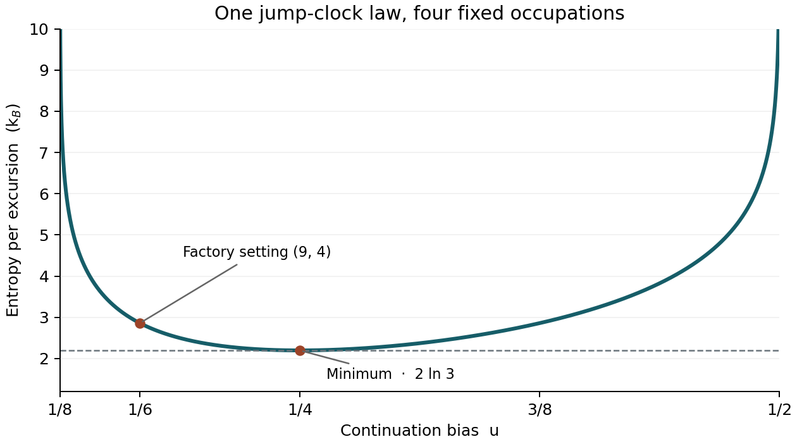

# The least dissipation when one hidden jump never occurs

Observe a finite stationary irreducible continuous-time Markov chain with one
individually visible state 0, reciprocal edge support and one effective
transition channel per ordered pair. Detect every jump and whether the state
is visible. Let $N$ count internal hidden jumps between departure from 0 and
first return. Write $m=P(N\ge1)$, $r=P(N\ge2)$, $n=E[N]$, and let $\nu>0$
be the excursion frequency. The condition **$r=m$** says that $P(N=1)=0$ in
the population. It allows longer odd excursions.

For $0<m<1$, the physically possible means are exactly **$n>2m$**. Put
$b=n/2$, $q=1-m$, $d=\sqrt{[1-(1+b)q]_+}$, where $[x]_+=\max(0,x)$.
The compatible dimensionless entropies $S=\dot S_{\rm prod}/(k_B\nu)$ fill
**$[S_*,\infty)$**, with

$$
\boxed{S_* = 2d\left(\log\frac{1+d}{1-d}+\log\frac{b+d}{b-d}\right).}
$$

The minimum is positive exactly when $2m<n<2m/(1-m)$. A single four-state
cycle realizes the entire interval for each admissible pair. Along that
family the complete timestamped record seen by this observer, every labeled
stationary probability, every exit rate and the total activity are fixed.
The amount of entropy above the minimum has no finite upper bound. For
$m=0$ the only triple is $m=r=n=0$, with a star graph and zero dissipation.

For $m>0$ the smallest realization has **four states** including 0, except
at $n=2m/(1-m)$ with $S=0$, where **three states** suffice. With only two
hidden sites, both cannot neighbor 0 because an internal jump between them
would permit a one-jump excursion. The support must be a path starting at
0. Each hidden round trip restarts at the original entrance, so the chance
of another pair is $m$ and $n=2m/(1-m)$. The path satisfies detailed
balance and choosing its continuation probability $m$ realizes this case.

For example, take $m=r=5/8$ and $n=2$. Every compatible finite network
dissipates at least **$2\log 3\,k_B$ per excursion**. With all four exit
rates equal to one and each occupation fixed at $1/4$, the same square can
realize every finite entropy rate from $(\log 3)/2\,k_B$ per time unit
upward. Every excursion that enters the interior then has a $3/8$ chance of
making another pair of hidden jumps. [Knob settings and replay](CAMPAIGN.md)

## Why the minimum holds at every hidden order

Let $B$ be the hidden neighbors of 0 and $C$ the remaining hidden sites.
An edge within $B$ would give a positive-probability excursion $0,i,j,0$.
Consequently every excursion with an internal jump crosses from $B$ to $C$
and back. Let $\ell$ be the expected number of outward crossings per
excursion. The same number come back. Reversibility of *support* allows
repeating a used crossing before returning to 0, so $m<\ell\le b$. Indeed
$n=2\ell+$ the expected count of $C$–$C$ jumps. Reciprocity also gives
a positive immediate-return probability.

Normalize stationary fluxes per excursion as $f_{ij}=\pi_iQ_{ij}/\nu$ for
$i\ne j$ with zero diagonal. For $i\in B$ write $e_i=f_{0i}$, $v_i=f_{i0}$
and $h_i=\sum_j f_{ij}$. Both $e,v$ have mass 1, $h$ has mass $1+\ell$,
and $q=\sum_{i\in B}e_iv_i/h_i$. The entropy on the boundary edges is the
Jeffreys divergence $J(e,v)=\sum_i(e_i-v_i)\log(e_i/v_i)$, omitting
double zeros. Summing the $B$–$C$ fluxes by their $B$ endpoint and applying
the log-sum inequality in both directions bounds their entropy below by
$J(h-v,h-e)$. These vectors have mass $\ell$. Each unordered edge occurs
once in the sum over $B\times C$. Entropy on the remaining edges is
nonnegative.

For equal-mass vectors $a,b'$ of mass $s$, put
$z^2=s^2-(\sum_i\sqrt{a_i b'_i})^2$. The sharp divergence bound is
$J(a,b')\ge2z\log[(s+z)/(s-z)]$. For the two applications here,
Cauchy–Schwarz gives

$$
\left(\sum_i\sqrt{e_i v_i}\right)^2\le(1+\ell)q,\qquad
\left(\sum_i\sqrt{(h_i-v_i)(h_i-e_i)}\right)^2
\le(1+\ell)(\ell-1+q).
$$

Thus both values of $z$ are at least
$d_\ell=\sqrt{[1-(1+\ell)q]_+}$. The two divergences yield the displayed
bound with $\ell$ in place of $b$. While positive, it decreases strictly
as $\ell$ increases, since $d_\ell$ and $d_\ell/\ell$ both decrease.
Substituting $b$ proves the lower bound. All logarithms are finite since
$d<1$ and, in the positive regime, $b^2-d^2=(1+b)(b-m)>0$.
[Proof of the divergence bound](../excursion-activity/RESULT.md#why-extra-hidden-states-cannot-lower-the-floor)

## A four-state minimizer in every regime

Order the cycle $0,B_+,C,B_-,0$. For $d>0$ assign the following fluxes per
edge in that cyclic orientation and in reverse.

| Edges | Forward | Reverse |
|---|---:|---:|
| $0\to B_+$ and $B_-\to0$ | $(1+d)/2$ | $(1-d)/2$ |
| $B_+\to C$ and $C\to B_-$ | $(b+d)/2$ | $(b-d)/2$ |

The row sums in cycle order are $1,(1+b)/2,b,(1+b)/2$. Every edge has net
current $d$. The return fraction is $(1-d^2)/(1+b)=q$, and the sum of the
four edge entropies is $S_*$. Row normalization gives the jump chain. Any
balanced construction here becomes a continuous-time chain at the specified
frequency by assigning exit rate $(2+n)\nu$ at every state. Stationary
masses equal row sums divided by $2+n$.

For the zero minimum, parameterize the same square by four jump
probabilities. At 0 enter $B_+$ with probability $p$. At $C$ return to
$B_+$ with probability $z$. At $B_+,B_-$ continue to $C$ with respective
probabilities $x,y$, otherwise exit to 0. The first continuation has
probability $m=px+(1-p)y$. Later continuations have probability
$t=zx+(1-z)y$. Consequently

$$
P(N\ge2j-1)=P(N\ge2j)=m t^{j-1}\quad(j\ge1),\qquad
b=\frac{m}{1-t}.
$$

Set $c=b/(1+b)$. When $m=c$, take $x=y=m$, $p=z=1/2$ for detailed balance.
When $m<c$, choose $y=m/2$, $m<x<1$, $p=(m-y)/(x-y)$. At equilibrium the
traffic from the two boundary sites into $C$ must total

$$
b(x)=\frac{px}{1-x}+\frac{(1-p)y}{1-y}
    =\frac{m-xy}{(1-x)(1-y)}.
$$

This increases strictly from $m/(1-m)$ to infinity as $x$ goes from $m$ to
one. Choose the unique $x$ giving the prescribed $b$, then set
$z=px/[b(1-x)]$. The boundary fluxes are $p,1-p$ in each direction,
and the two internal edge fluxes are $bz,b(1-z)$ in each direction.
All four edges are positive and detailed balance holds. This also proves
sufficiency of $n>2m$ over the three regimes.

## Every higher entropy on the same four labeled states

Start at the minimizer just constructed. Let $u$ be the fraction of the
total $B$ visit mass at $B_+$. Then $0<u<1$. Write $h=x-y$ for the spread,
choosing $B_+$ as in the construction. In all three cases $h\ge0$. Keep
$b,m,t,u$ fixed and increase $h$ towards
$h_{\max}=\min\{c/u,(1-c)/(1-u)\}$. Use

$$
x=c+(1-u)h,\quad y=c-uh,\qquad
p=u+\frac{m-c}{h},\quad z=u+\frac{t-c}{h}.
$$

At the positive minimum $u=1/2$ and $h=2d/(1+b)$. At the $m=c$ starting
point, $m=t=c$ and the formulas extend to $h=0$ by $p=z=u$.
These choices recover the starting probabilities because the $B$-visit
weighted average of $x,y$ is $c$. As $h$ increases, $p,z$ stay strictly
between zero and one, moving towards $u$. The formulas preserve the two
continuation probabilities and the row sums
$1,(1+b)u,b,(1+b)(1-u)$, since $m+bt=b$ and $p+bz=(1+b)u$.

With the equal exit rates fixed, all holding times are independent identically
distributed exponentials independent of the jump chain. The return to 0
renews the process. The paired tail law above therefore fixes the entire
stationary record of visible labels and jump timestamps. Total jump
activity is $(2+n)\nu$. As $h\uparrow h_{\max}$, either $y\downarrow0$
or $x\uparrow1$. In the first case the flux $B_-\to C$ vanishes while
$C\to B_-$ stays positive. In the second case $B_+\to0$ vanishes
while $0\to B_+$ stays positive. The entropy diverges. Continuity from an
attained minimum now gives every finite value in the interval. All rates on
the cycle are strictly positive at each finite member.

## What equality and a later odd count tell the observer

At a positive minimum, strict decrease in $\ell$ forces $\ell=b$. There
are no $C$–$C$ edges. Equality in both Cauchy bounds implies that for each
$i\in B$ the unordered pair $e_i/h_i,v_i/h_i$ is
$\{(1+d)/(1+b),(1-d)/(1+b)\}$. Indeed the product is $q/(1+b)$ and
the sum is $2/(1+b)$. Partition $B$ by the sign of $e_i-v_i$. Flux balance
gives total visit mass $(1+b)/2$ in each class. Equality in row log-sum
requires $f_{ij}/f_{ji}=\rho=(b+d)/(b-d)$ from the positive class to $C$
and $1/\rho$ from the negative class. At each $C$ site, balance now forces
the outgoing masses towards the two classes to be in ratio $1:\rho$.
Every positive minimizer therefore projects, at jump epochs, to exactly the
minimizing four-state square. This forces the complete paired count law even
if the hidden network has more sites. The argument permits unequal holding
rates within a class.

On any trajectory $N=2L+D$ where $L$ counts outward crossings and $D$
counts $C$–$C$ jumps. If $o$ is any lower bound on $P(N\text{ odd})$ then
$E[D]\ge o$ and $\ell\le(n-o)/2$. Evaluating the same formula at **$b=(n-o)/2$**
gives a valid, potentially stronger lower bound. For a five-state example,
start with a four-state cycle of clockwise flux 4 and reverse flux 2, in
cyclic order $0,1,2,3$. Add flux 1 both ways between site 4 and each of
1 and 2, then add a unit of directed flux along $1,2,4,1$. The resulting
balanced flow gives

$$
m=r=11/18,\qquad n=19/6,\qquad P(N=3)=19/576 .
$$

The first three statistics admit equilibrium. Adding the population
probability of exactly three jumps forces **at least $0.0116979\,k_B$ per
excursion**. Sharpness with this fourth observation remains open.
[Independent propagation on this network](../../../crates/physis-theory/tests/excursion_activity/entropy.rs)

## Scope and prior work

Kienker derived observational equivalences for aggregated continuous-time
Markov models. Kapustin, Ghosal and Bisker studied counting transitions
between unresolved states. Nitzan, Ghosal and Bisker optimized entropy
using observed flows and waiting-time information. The specific result here
concerns the exact population condition $P(N=1)=0$, an unrestricted finite
hidden order, and a four-state realization with fixed clock and occupancies.
Inferring that population condition from a finite sample requires additional
assumptions. Historical priority and experimental
applicability remain open. [Kienker](https://doi.org/10.1098/rspb.1989.0024) ·
[Kapustin et al.](https://doi.org/10.1103/PhysRevResearch.6.023039) ·
[Nitzan et al.](https://doi.org/10.1103/PhysRevResearch.5.043251)

The accompanying result gives a quantitative bound for general triples,
including records with a positive one-jump probability. [Linear dissipation bound](LINEAR.md)
