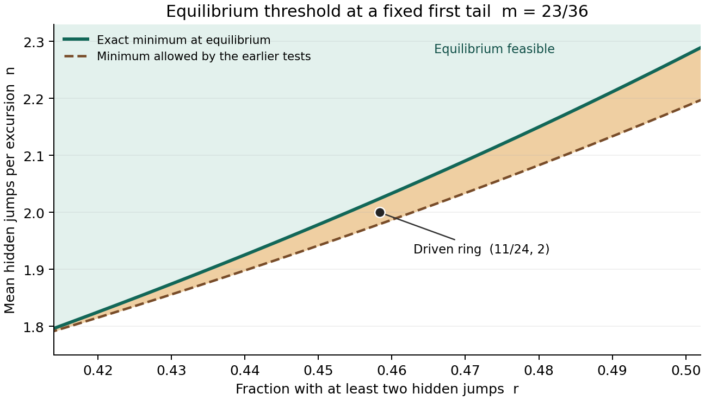

# Exactly which three excursion counts admit equilibrium?

Consider a finite stationary irreducible continuous-time Markov chain with one
individually visible state 0, reciprocal edges and one effective channel per
ordered pair. Count every physical jump. During a complete excursion from 0
back to 0, let $N$ count jumps internal to the hidden set. The data are

$$
m=P(N\ge1),\qquad r=P(N\ge2),\qquad n=E[N].
$$

For a given pair of count tails, the **minimum mean compatible with equilibrium**
has an algebraic formula. At every interior point of this frontier the smallest
equilibrium realization has **four hidden states**. On a separate boundary,
equilibrium is impossible even though the entropy infimum is zero at the
*exact* data. These statements are about population observations. Any specified
excursion frequency $\nu>0$ may be matched by rescaling time.

## Feasibility and dissipation

Write $S=\dot S_{\rm prod}/(k_B\nu)$, the dimensionless entropy per excursion.
The table assumes the measurements come from some chain in the stated class.
For a nontrivial excursion law, $0<r\le m<1$ and $n>m+r$. Every entrance can
be reversed, and after a possible first internal jump its edge can be
repeatedly traversed in both directions. If $m=0$, then $r=n=0$ and the
connected support is a star with $S=0$.

| Count tails | Means admitting equilibrium | Entropy for other physically realizable means |
|---|---|---|
| $r<m^2$ | None | A strictly positive lower bound |
| $r=m^2$ | Only $n=m/(1-m)$ | Below this mean the floor is positive. Above it the feasible interval is $(0,\infty)$ |
| $m^2<r<m$ | Every $n\ge n_*(m,r)$ | A strictly positive lower bound for $n<n_*$ |
| $r=m$ | Every $n\ge 2m/(1-m)$ | A strictly positive lower bound for smaller $n$ |

Wherever equilibrium is attained in the nontrivial domain, every finite
$S\ge0$ is attainable at the same data, by the earlier hidden-state lift.
A subsequent four-state construction gives the sharp positive minimum and the entire interval at $r=m$. The general interior positive minimum remains open.
[Sharp minimum for a missing one-jump count](../excursion-entropy/RESULT.md) · [Linear bound for general triples](../excursion-entropy/LINEAR.md) ·
[Lift preserving the entire jump clock](../excursion-activity/RESULT.md#why-even-a-complete-jump-clock-has-no-finite-upper-bound) · [Unattained zero and positive bounds](BOUNDARY.md)

For $m^2<r<m$, take the unique positive root $a$ of

$$
a^3+ma^2-ma=r.
$$

Put $D=1+a-a^2$, $t=a^2$, $s=a^3/D$ and $w=(m-r)/(t(1-t))$. Then

$$
\boxed{\displaystyle n_* = w\,\frac{t}{1-t}+(1-w)\,\frac{2s}{1-s}.}
$$

On four sites arranged in a ring, use clockwise, anticlockwise and opposite
jump weights 3, 2 and 1 at every site. Its measurements are $m=23/36$,
$r=11/24$, $n=2$. Each of the three pairs admits equilibrium. The earlier
joint test also passes, with residual $(1+m)^2-(1+2n)(1-r)=-29/1296$.
Yet $2.02408322<n_*<2.02408323$. Every compatible network dissipates more
than $0.0000845\,k_B$ per excursion. The grid found 18 settings like this
beyond the 22 detected by the earlier joint test.
[Rational certificates and factory replay](CAMPAIGN.md) · [Earlier joint test](../excursion-activity/JOINT.md)

## Two reversible branches suffice for the minimum

The **geometric branch** has two hidden sites. Enter them equally, return
to 0 with probability $1-x$ at each, otherwise jump to its partner.
The **even-return path** enters one hidden site. With probability $y$ it
makes a round trip to a second site and tries again, otherwise it exits.
Their triples in the order $(m,r,n)$ are

$$
G(x)=(x,x^2,x/(1-x)),\qquad P(y)=(y,y,2y/(1-y)),\quad 0\le x,y<1.
$$

At parameter zero use an immediate return. Mixing branches at 0 with the
specified departure weights preserves reversibility, since each branch's
balanced symmetric fluxes can be multiplied by its weight.

To reduce an arbitrary equilibrium network, use symmetric stationary edge
traversals per excursion $f_{ij}=\pi_i Q_{ij}/\nu$ with diagonal zero. Let
$h_i=\sum_j f_{ij}$ be the hidden visit mass, $v_i=f_{i0}/h_i$ the chance
to exit, and $x_i=1-v_i$. The entrance probability for $i$ is $h_iv_i$.
Therefore $m=\sum_i h_iv_ix_i$, $m-r=\sum_{i,j\ne0} f_{ij}v_iv_j$ and
$n=\sum_{i,j\ne0} f_{ij}$.

Split each internal unordered edge $ij$ of flux $f=f_{ij}>0$ into its own
branch at 0. Assign boundary flux $fv_i/x_i$ at its copy of $i$ and
$fv_j/x_j$ at its copy of $j$. These fluxes preserve the exit probabilities
at both copies. At each original site with $x_i>0$ the assigned boundary
fluxes sum to $h_iv_i$. Sites with $x_i=0$ supply immediate returns. An edge
with $v_i=v_j=0$ adds $2f$ to $n$ and zero to the boundary mass and both
short-count probabilities. Omit such edges from the branch mixture and keep
this nonnegative excess mean. The three flux formulas above prove the
decomposition even when hidden sites are several edges away from 0.

On a branch of positive boundary mass put $x=x_i$, $y=x_j$. Alternation
gives $r_b=xy$ and $n_b=(m_b+r_b)/(1-r_b)$. Its entrance weights are
proportional to $(1-x)/x,(1-y)/y$, so
$m_b=xy(2-x-y)/(x+y-2xy)$. Also $r_b\le m_b$ and

$$
(x+y-2xy)^2(r_b-m_b^2)=xy(x-y)^2(1-xy)\ge0.
$$

At fixed $r_b$, the branch mean is affine in $m_b$. The endpoints of
$r_b\le m_b\le\sqrt{r_b}$ are precisely $P(r_b)$ and $G(\sqrt{r_b})$.
Interpolating gives the same three statistics. Every equilibrium network thus
gives a convex combination of the two displayed curves, possibly with extra
mean from the omitted edges. Jensen also gives $r\ge m^2$ for the mixture.

## A supporting plane that a finite network attains

For a trial parameter $0\le a<1$, define

$$
D=1+a-a^2,\quad B=1+2a-a^2,\quad A=2D^2-B,\quad
M=(1+a)^2(1-a^2)^2.
$$

Every equilibrium network obeys $Mn\ge Am+Br-2a^6$. It suffices to check
both curves because $M>0$. After multiplying their slacks by $1-x$ or
$1-y$, respectively, they factor as

$$
\begin{aligned}
Mx-(1-x)(Ax+Bx^2-2a^6)&=(x-a^2)^2(Bx+2a^2),\\
2My-(1-y)((A+B)y-2a^6)&=2(Dy-a^3)^2 .
\end{aligned}
$$

Choose the root in the theorem. The cubic has one positive root by its signs.
At $a=\sqrt m$ its left side is $m^2$, and at $a=1$ it is 1, so
$\sqrt m<a<1$. The root also gives $m=s+(m-r)/D$. Since
$t-s=t(1-t)/D$, we have $s<m<t$ and $0<w<1$. The mixture $wG(t)+(1-w)P(s)$
therefore realizes $m,r$. It touches the plane on both branches, giving
exactly $n_*$. Solving a single cubic suffices at arbitrary finite hidden order.

Equality also proves the state count. A minimizing network has no omitted
positive internal traffic or immediate-return branches, since either has
strict slack. Each remaining edge must be entirely of type $G(t)$ or $P(s)$.
Indeed an interior interpolation would need its same second tail to equal
both $t^2$ and $s$. Here $s-t^2=a^3(1-a)(1-a^2)/D>0$. A geometric edge
joins two distinct sites with continuation $t$, by the squared identity
above. A path edge joins sites with continuations $s$ and 1, since $r_b=m_b$
requires zero probability of a one-step internal excursion. Both edge types
occur, and $s,t,1$ are distinct. This requires four hidden sites and the
displayed construction uses exactly four.

## Every larger mean is reachable

Fix $m^2<r<m$ and write $d=m-r$, $v=r-m^2$, $k=1-2m+r>0$. Choose
$0\le y<v/k$. Give the geometric branch first tail $t=(r-y)/(m-y)$
and weight $w=(m-y)^2/(r-y)$. Give the other branch the path parameter
$s=y/(1-w)$. These choices preserve $m$ and $r$. The identities
$rk-v=d^2$ and $(1-w-y)(r-y)=v-ky>0$ give $0<t<1$, $0<w<1$, $0\le s<1$.
The mean of the mixture is

$$
F(y)=\frac{(m-y)^2}{d}+2y+\frac{2y^2(r-y)}{v-ky}.
$$

The minimizing mixture is a member at $y=(1-w)s$. As $y$ increases to
$v/k$, $F$ tends to infinity. Continuity realizes every larger finite mean
on the same five sites. At $r=m$, the singleton and even-return path mixture
gives the mean interval in the table. At $r=m^2$, the reversible spectral
measure has zero variance, hence all count tails are $m^\ell$, forcing
$n=m/(1-m)$. A single geometric branch realizes it. [Boundary constructions and spectral proof](../excursion-activity/JOINT.md)

## Prior work and scope

Kapustin, Ghosal and Bisker recorded jumps between unresolved sites and
grouped excursions by count. Ehrich optimized dissipation over hidden
Markov networks compatible with observations. Aldous and Fill give the
classical reversible spectral setting. Petkov studies equilibrium realization
of observation matrices through complete positivity. The claim here is an
explicit compatibility criterion for these three scalar observations and a
minimal realization of its lower frontier. Historical priority and performance
on sampled experimental records remain open.
[Kapustin et al.](https://arxiv.org/html/2212.13487) · [Ehrich](https://arxiv.org/abs/2105.08803) · [Aldous and Fill](https://www.stat.berkeley.edu/~aldous/RWG/Book_Ralph/Ch3.S5.html) · [Petkov, preprint](https://hexagonmath.org/2611.00658v1)
